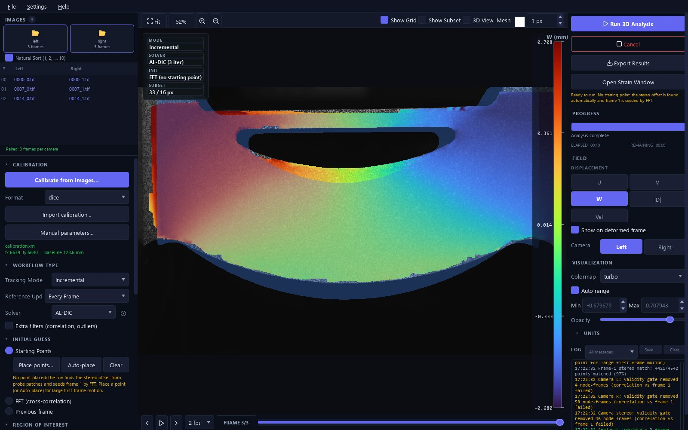

# Quickstart: a real stereo-DIC analysis

This folder holds a small real dataset and everything needed to analyse it: three
image pairs of a D-shaped specimen being pulled apart, the stereo calibration, and
a mask of the specimen in every image. Work through it once in the desktop app
(**Option A**, about five minutes) or run it with one command (**Option B**). It is
the fastest way to learn the workflow before you load your own images.

You need pyALDIC-3D installed (`pip install al-dic-3d`, or the Windows installer
from the [latest release](https://github.com/zachtong/pyALDIC-3D/releases/latest))
and this folder on your computer: clone the repository, or on its GitHub page
choose **Code › Download ZIP** and unzip it.

## The dataset

```
quickstart/
├── left/             0000_0.tif  0007_0.tif  0014_0.tif    left camera, 1920 × 1200, 8-bit
├── right/            0000_1.tif  0007_1.tif  0014_1.tif    right camera
├── masks/left/       one mask per left image (white = specimen), same file names
├── masks/right/      one mask per right image
├── calibration.xml   the stereo calibration (DICe format)
└── config.toml       the same analysis for the command line (Option B)
```

The images are frames 0000, 0007 and 0014 of the **Stereo-DIC Challenge 1.0,
Sample 3** sequence (see [About the data](#about-the-data)). The specimen is a
plate with a D-shaped outline and a lens-shaped cut-out, gripped at both ends and
stretched. Between these three frames it moves by several millimetres and starts
to deform strongly around the cut-out, which makes it a good first example: it
needs the right tracking mode, and the mask matters.

## Option A: the desktop app

Start the app with `al-dic-3d gui` (or the *pyALDIC-3D* Start-menu entry of the
Windows installer). The window has three columns: setup on the left, the image in
the middle, run and display controls on the right.

1. **Load the images.** In **IMAGES**, click the **LEFT** drop zone and choose the
   `quickstart/left` folder, then click the **RIGHT** zone and choose
   `quickstart/right` (dragging the folders onto the zones works too). The status
   line reads *Paired: 3 frames per camera*.
2. **Load the calibration.** In **CALIBRATION**, set **Format** to `dice`, click
   **Import calibration…** and choose `quickstart/calibration.xml`. The status
   line shows the focal lengths (about 6640 px) and a 123.6 mm baseline.
3. **Choose the tracking mode.** In **WORKFLOW TYPE**, set **Tracking Mode** to
   **Incremental**. Each frame is then compared with the previous one instead of
   with the first, which this specimen needs: it moves several millimetres
   between frames 2 and 3.
4. **Set the region of interest.** Scroll down to **REGION OF INTEREST**. Under
   **Per-frame masks**, click **Import…** on the *Left* row and choose
   `quickstart/masks/left`, then **Import…** on the *Right* row and choose
   `quickstart/masks/right`. The first left mask becomes the region of interest,
   the whole D-shaped specimen, and the mesh appears on it.
5. **Run.** Click **Run 3D Analysis** at the top of the right column. The run
   takes about 10–15 s. The first run after installing takes longer, because
   the numerical kernels are compiled once.
6. **Look at the result.** The *Strain Post-Processing* window opens by itself;
   leave it for a moment. In the main window, under **FIELD**, click **W** (the
   out-of-plane displacement) and drag the frame slider at the bottom to
   **FRAME 3/3**. Your window should now look like this:

   

   Try **U**, **V** and **|D|**, and tick **3D View** above the image to see the
   reconstructed surface. In the strain window, click **Compute Strain** to get
   the surface strain (ε₁, εxx, von Mises, …) on every frame.
7. **Keep the result.** **Export Results** writes images, animations and data
   tables; **File › Save Project** stores the whole analysis in one `.aldic3d`
   file that reopens where you left off.

### What you should get

| | Frame 1 (0000) | Frame 2 (0007) | Frame 3 (0014) |
|---|---|---|---|
| Valid points on the specimen | 97.3% | 97.1% | 96.4% |
| Median displacement \|D\| | 0 | 0.45 mm | 3.7 mm |
| Out-of-plane W (2nd–98th percentile) | 0 | 0.04 to 0.10 mm | −0.68 to +0.71 mm |
| Principal strain ε₁ (median / 99th percentile) | 0 | 0.1% / 0.5% | 4.5% / 18.5% |

The mesh has 6,372 points, of which 4,542 lie on the specimen. The few percent
that are not valid sit along the outer edge and the cut-out, where a subset
reaches past the material. They are left empty rather than filled with guesses.
The specimen surface is 375–393 mm from the left camera.

## Option B: the command line

From the folder that contains `quickstart/`:

```bash
al-dic-3d run quickstart/config.toml
```

With the Windows installer, use the `pyaldic3d-cli.exe` in the installation folder
(by default `%LOCALAPPDATA%\Programs\pyALDIC-3D`) in place of `al-dic-3d`, for
example in a Command Prompt:

```bat
"%LOCALAPPDATA%\Programs\pyALDIC-3D\pyaldic3d-cli.exe" run quickstart\config.toml
```

The paths in [`config.toml`](config.toml) are relative to the file, so the
command works from any folder; the file lists the same choices as steps 2–4
above. After about 15 s the output reports

```
analysis complete - 3 frames, median validity 97%, 0 frame(s) below 70%
```

and `quickstart/results/` holds `d_specimen.npz` and `d_specimen.mat` (3D points,
U/V/W/|D|, every strain component, and the raw correspondence) plus a JSON record
of the parameters. To read the results in Python:

```python
import numpy as np

d = np.load("quickstart/results/d_specimen.npz")
print(d["points3D"].shape)          # (3, 6372, 3): frames x points x (X, Y, Z) in mm
w = d["W"][2]                       # out-of-plane displacement on frame 3, mm
print(np.nanpercentile(w, [2, 98])) # about [-0.68, 0.71]
```

`--formats npz,csv,ply,vtu` adds per-frame CSV tables, PLY point clouds
(MeshLab, CloudCompare) and a VTU time series for ParaView.

## Things to try

- **Accumulative tracking.** Set **Tracking Mode** back to **Accumulative** and run
  again. Frame 3 fails completely: compared directly with frame 1, the specimen
  has moved and deformed too much to be found. The log says so and suggests
  Incremental.
- **Draw your own region of interest.** Click **Clear** on both mask rows, remove
  the region of interest (right-click the image › **Clear ROI**), then use
  **+ Add › Rectangle** to drag a box below the cut-out on frame 1, and run
  again. In Incremental mode every later reference frame reuses the outline you
  drew, so points that move out of it near the edges are dropped (about 7% of a
  box here). Per-frame masks, as in step 4, follow the specimen instead.
- **Strain settings.** In the strain window, change the **Strain window** size,
  the strain type and the coordinate system, and compute again.

The [User Guide](../docs/user-guide/index.md) explains every control.

## About the data

The images are **Sample 3 of the Stereo-DIC Challenge 1.0** of the International
Digital Image Correlation Society (iDICs); the full image sets are available
from the [iDICs challenge page](https://idics.org/challenge/). The challenge is
described in W. Ahmad, J. Helm, S. Bossuyt, P. Reu, D. Turner, L. K. Luan,
P. Lava, T. Siebert and M. Simonsen, *Stereo-DIC Challenge 1.0 – Rigid Body
Motion of a Complex Shape*, Experimental Mechanics 64, 1073–1106 (2024). Please
acknowledge the challenge when you use the images.

The sequence continues to frame 0033, where the specimen breaks. Its analysis
from start to failure is Case 3 of Z. Tong and J. Yang, *3D Stereo Adaptive Mesh
Augmented Lagrangian Digital Image Correlation*, Experimental Mechanics (2025),
[doi:10.1007/s11340-025-01225-7](https://doi.org/10.1007/s11340-025-01225-7);
`calibration.xml` is the DICe calibration published with that case.
